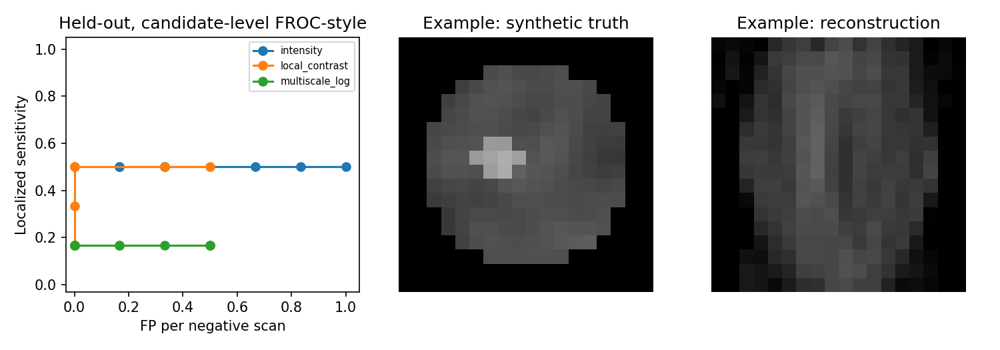

# Synthetic Breast Imaging: Limited-Angle Reconstruction & Lesion Detection

[](https://www.python.org/) 

An independent, **non-clinical computational research pilot** exploring limited-angle X-ray reconstruction, simplified 3-D cone-beam geometry, projection consistency, and synthetic breast-lesion candidate detection.

This repository documents **16 iterations of exploratory experiments**, including negative results and limitations. It was developed to practice computational medical imaging research methods. **It is not a diagnostic system, a clinical validation study, or a reproduction of a specific Radboudumc system.** No patient images are included.

## Key experiment: V16

Three conventional candidate-detection baselines were compared on simulated reconstructed 3-D volumes containing lesions and paired hard-negative distractors. Detection thresholds were selected from the development subset; held-out seeds were used only for evaluation.

| Detector | Localized true positives | False-positive negative scans | Mean candidate-centre error |
|---|---:|---:|---:|
| Smoothed intensity | **3 / 6** | 1 / 6 | 3.43 voxels |
| Local contrast | 1 / 6 | **0 / 6** | 4.18 voxels |
| Multiscale LoG | 1 / 6 | **0 / 6** | 6.30 voxels |

These results are from **only six held-out positive and six held-out negative synthetic cases**, and must not be interpreted as clinical sensitivity or specificity. See [V16 methodology and limitations](reports/RESULTS_V16.md).



## Research questions

- How do angular coverage, detector field of view, and projection count affect recovery of a synthetic lesion?
- When does smoothing or regularization improve image similarity but damage lesion fidelity?
- How robust are simple candidate detectors to harder negative examples and variable lesion contrast?

## Getting started

```bash
git clone https://github.com/sanatat/Synthetic-Breast-Imaging-Limited-Angle-Reconstruction-Lesion-Detection.git
cd Synthetic-Breast-Imaging-Limited-Angle-Reconstruction-Lesion-Detection
python3 -m venv .venv
source .venv/bin/activate
python -m pip install -r requirements.txt
OPENBLAS_NUM_THREADS=1 python run_v16.py --seeds 12 --steps 70
python -m unittest discover -p 'test_*.py' -v
```

The clone URL above points to this repository. This project is designed to run on CPU; V16's simulated system-matrix calculations can take time. Results are written to `results_v16/` (ignored by Git).

For a smaller smoke run (not comparable with the reported results), use:

```bash
OPENBLAS_NUM_THREADS=1 python run_v16.py --seeds 8 --steps 10
```

## Repository guide

| Location | Contents |
|---|---|
| `run_experiment.py`, `run_v2.py`–`run_v16.py` | Standalone historical experiment entry points |
| `test_experiment.py`, `test_v2.py`–`test_v16.py` | Unit and smoke tests |
| `reports/RESULTS*.md` | Contemporaneous result write-ups and limitations |
| `figures/` | Selected, reproducible synthetic result figures |
| `results/*_summary.json` | Snapshots of reported numerical results |
| `.github/workflows/tests.yml` | GitHub Actions smoke/unit test workflow |

Some experiment modules import functions defined in earlier scripts. Keep the root-level `run_v*.py` files together. The scripts are research prototypes, not a packaged library.

## Scientific limitations

1. Synthetic volumes and simple tissue textures do not represent the anatomical variability of real breasts.
2. Simplified X-ray projector/detector geometry is not a calibrated clinical digital breast tomosynthesis (DBT) scanner.
3. Several experiments use the same forward model to generate and reconstruct data, introducing *inverse crime*.
4. Earlier experiments use ultrasound *surrogates*, **not actual ultrasound acquisitions** or fully independent acoustic-wave simulations.
5. V16 uses a single maximum-score candidate per scan, so its FROC-style plot is not a complete multiple-candidate FROC.
6. Results are not externally validated and provide no clinical performance estimate.
7. Historical experiments may have different evaluation settings; cross-version headline metrics should not be directly interpreted as a controlled longitudinal benchmark.

## Selected findings

- Increasing angular span improved lesion recovery in several synthetic settings, but this is not directly a DBT result.
- Increasing X-ray views alone did not consistently reduce lesion MAE in the toy geometry; projector coverage, iteration count, and noise merit careful investigation.
- Stronger regularization sometimes improved image-wide similarity while reducing lesion intensity fidelity.
- In the more difficult V16 experiment, the simplest intensity-based detector localized more lesions but also produced a false alarm.

## Reproducibility

The reported JSON summaries are included as snapshots. Rerunning scripts regenerates output and may overwrite local output directories. Check the `--help` flag of each script for available settings. Main dependencies: NumPy, SciPy, scikit-image, Matplotlib.

## Ethics and use

**Research/education only. Not for medical use.** No patient data or patient-specific predictions.

## License

MIT (see [LICENSE](LICENSE)).
